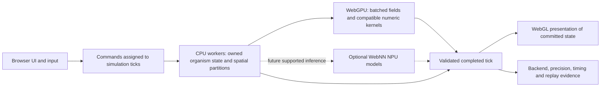

<!-- reviewed: 2026-06-27 | repo-wide consistency audit | canonical facts: docs/VERIFICATION-ANALYTICAL-DATA.md -->

# ADR 0010 — Worker offload + streamed "Hybrid world" for scaling

- Status: Browser-only migration; CPU workers operational, experimental calibrated ambient WebGPU backend; full-world performance benefit unproven; visible-core parallelization remains planned
- Date: 2026-06-20
- Governs: Scaling stages 3–5 ([BENCHMARKS-2026-06-26.md](../BENCHMARKS-2026-06-26.md) § Scaling Stages)

## Browser-only heterogeneous execution — 2026-10-23

The owner selects GitHub Pages as the deployment target. No native daemon, direct CUDA API,
driver installation, local Python service or cloud compute is required by the application.
Browser WebGPU can execute on an NVIDIA GPU through the browser graphics stack; this is not
native CUDA. WebNN is an optional browser capability, not a guarantee that an NPU can execute a
particular model. No CQM NPU inference model has been wired or executed in this migration.

### What is implemented

- `src/core/wilderness-webgpu.ts` ports the complete existing wilderness movement, seeded random
  perturbations, resource seeking, threat anticipation and boundary behavior into one batched WGSL
  dispatch. Type/identity lanes are preserved; caller inputs are not transferred or mutated. Buffers
  are bounded and reused. Loss, timeout and invalid results retire the executor and retain CPU fallback.
- `src/core/wilderness-compute.ts` performs numerical checks against the existing CPU kernel and
  transfer-inclusive timing against the worker route. Automatic selection requires a measured win;
  a detected GPU alone is insufficient. FP32 numerical agreement is tolerance-based, not a bitwise
  cross-device guarantee. The runtime probe is a bounded startup sample, not a sustained FPS test.
  Auxiliary dispatch is held and existing worker jobs drain before calibration; visible simulation
  and presentation continue, so this remains an in-session routing observation, not an isolated
  hardware benchmark. A worker that fails numerical parity is detached and retired.
- `WildernessPopulation` owns one in-flight frame and one latest queued request. Epochs and chunk
  identity reject late publication after reset, pause, replacement, unload or disposal. The accepted
  frame and backend, errors and fallbacks are inspectable through `World.getBrowserComputeStatus()`.
- The worker budget defaults to logical processors minus two (minimum one) to leave browser/driver
  headroom. `?workers=N` permits an explicit bounded override; `?workers=0` retains the synchronous
  route. Browser workers do not guarantee affinity to particular performance or efficiency cores.
- `?compute=auto` calibrates optional ambient GPU work in live mode. `?compute=cpu` retains CPU
  execution. `?compute=webgpu` is an explicit experiment that still requires numerical checks but may
  choose a slower GPU. Seeded mode retains the CPU reference. The HUD scopes its backend readout to
  **ambient numerical work**, separately from visible core cognition.

**Scope limitation:** `WildernessRenderer` is intentionally a no-op. These existing numerical
organisms are not the visible core fauna, and this backend does not accelerate their 70-parameter
controllers, the Archons, the visible connectome or WebGL rendering. The auxiliary substrate-summary
duplication described below remains. Neither auxiliary offload is a substitute for the next stages.

The concurrent organism-biology addition is also integrated: physiology and four-channel memory
follow stable entity identity through deletion, compaction, reuse and Genesis. Its five habitat bands
and four developmental categories run on the main CPU thread, with accumulated simulation dt and one
wild entropy salt per batch. They are phenomenological variables, not validated neurobiology.
`planHybridPartition` is a proposal; actual entity-brain receipts report calling-thread CPU Zig WASM.
The prototype brain WGSL and exported shard helper are not dispatched by the application. No
connectome renderer culling, horizontal world enlargement or body morphing follows from their
estimated parameter outputs. These limitations also apply to upstream `7ae20238` descriptions.

### Target ownership and migration order

This diagram is the target architecture; only the ambient lane above has an additional backend.

1. **Parallel complete organism controllers.** Extract the complete per-organism controller,
   including actor/value traces, semantic recurrent state, genome and learning flags. Keep stable
   brain identities resident in worker shards. Pack senses/goals once, evaluate disjoint identities
   concurrently, and merge in stable order before integration. Birth, death and slot compaction carry
   generations so a late result cannot attach one organism's memories to another. Preserve the CPU
   reference path and test identical learned state, not only final positions.
2. **Independent simulation and presentation clocks.** A simulation coordinator owns step admission
   and commit barriers; the main thread renders the last completed state and handles input. Bound
   outstanding work. If full cognition cannot keep real time, report simulation-time throughput
   instead of silently skipping minds or changing their models. The current once-per-rAF World loop
   is not yet this coordinator. Fixed visual settings remain separate from simulation fidelity.
3. **GPU-resident batches.** Keep large field/organism arrays on the GPU across steps; group kernels
   by shape while preserving each individual's weights. Avoid per-organism requests and repeated
   CPU/GPU round trips. WebGL/WebGPU resource sharing is not assumed: a migration of render buffers
   must be measured against readback cost and the existing renderer. Connectome activation currently
   has traversal-order dependencies; unordered atomic propagation would change its mathematical model.
4. **Optional NPU inference.** Introduce only models that add measured perception or prediction value.
   Request a supported WebNN device, compile a concrete graph, execute controls and report the actual
   provider. An absent API/operator/model means inactive, with the CPU/GPU path intact. Small evolving
   per-organism networks and online training are not assumed appropriate NPU workloads.
5. **Persistent expanded world.** Spatial partitions need neighbor halos, stable global identities,
   bounded resident state and IndexedDB checkpoints with explicit eviction semantics. Preserve the
   declared causal rules for interactions across chunks. Increasing domain extent, reducing distant
   fidelity, or changing globally coupled fields is an experiment/configuration change, not a free
   optimization. Do not inflate entity counts before the step budget is measured.
6. **Deeper organisms.** Spend measured headroom on persistent memory, learned world predictions,
   homeostatic goals, embodiment, development, repair and social learning. Each addition needs an
   intervention and held-out task that distinguishes a working faculty from extra variables. Parameter
   count, population count and throughput alone do not establish greater intelligence or aliveness.

### Acceptance and scientific fidelity

Affected CQM-25 axes: `substrate_pluralism`, `instrumentation_reproducibility`,
`visual_embodied_scale`; later stages additionally target `memory`, `learning`,
`predictive_causal_models`, `morphology_development`, `homeostasis`, `repair_resilience`,
`social_communication` and `environmental_coupling`. Scores remain uncalibrated.

CPU concurrency can preserve reproducibility with read-only tick inputs, owned output partitions,
explicit barriers, stable merge order and explicit RNG streams. Determinism does not require one
thread. GPU arithmetic can require declared tolerances and long-run behavioral comparisons. Keep
a reproducible reference mode and record backend/version/precision for accelerated runs.

Acceptance for the core migration includes controller and recurrent-state parity, population
lifecycle/compaction, reordered completion, loss/timeout, bounded memory, unchanged visual materials,
matched-seed behavior and held-out learning performance. Measure end-to-end pack/queue/compute/
transfer/commit and delivered-frame p50/p95/p99, GPU timing, simulation-time throughput and memory
after warmup. Archive negative runs. A kernel-only benchmark, a screenshot, or high utilization
cannot establish the full-world performance claim.

References: [WebGPU](https://developer.chrome.com/docs/web-platform/webgpu/overview),
[WebNN availability](https://learn.microsoft.com/en-us/windows/ai/directml/webnn-overview),
[ONNX Runtime Web providers](https://onnxruntime.ai/docs/tutorials/web/env-flags-and-session-options.html),
[Intel 275HX specifications](https://www.intel.com/content/www/us/en/products/sku/242293/intel-core-ultra-9-processor-275hx-36m-cache-up-to-5-40-ghz/specifications.html).

## Worker runtime baseline retained from 2026-10-21

Upstream had already restored the default browser worker path before this repair. `src/main.ts`
initializes a pool when `Worker` is available unless the URL explicitly selects `?workers=0`;
`World.attachWorkerPool` attaches it to the wilderness after asynchronous initialization. The
constructor starts with a null pool, and initialization failure leaves the synchronous path active.
The built module URL is resolved with
`new URL('./workers/simulation-worker.js', document.baseURI).href`, so both a root deployment and
the repository's GitHub Pages subpath address the emitted worker asset relative to the document.
The presence of a visual-smoke rAF gate must not silently change the application's worker policy.

The worker also accepts Tsotchke simulation-summary tasks. `World` retains the synchronous substrate
step and stores the asynchronous result separately for telemetry; attaching the pool is not evidence
that this work was removed from the main thread. Neither worker summaries nor wilderness results
may feed the seed-only core golden.

`scripts/browser-visual-smoke.ts` deliberately sets `?workers=0` for its bounded visual fixtures.
Their `dormant-main-thread` expectation describes that explicit fixture, not the default application.
A separate default-worker probe removes that query parameter, visits the actual
deployment base path, observes the worker URL, and allows one bounded natural frame. Further rendering
is then held while default workers stay enabled, isolating a successful finite simulation-task
round trip. It writes `visual-smoke-default-workers.json` with measurement class
`default-worker-initialization-and-roundtrip-not-production-fps`; failures produce bounded receipts.
This is functional initialization and messaging coverage. It establishes neither a throughput gain
nor improved delivered-frame cadence. Production-shaped cadence measurements remain required for
any performance claim; no such improvement is asserted by this repair.

## Historical operational override — 2026-07-12

The July override constructed `WildernessPopulation(null, seed)` and kept `World.workerPool` null.
Its recorded reason was multi-second delivered-frame stalls despite plausible nominal FPS during
the worker-enabled path. That shutdown is historical; the current default-enabled path is described
above. The warning against treating an FPS counter or a functional worker round trip as performance
proof remains applicable. Lower-fidelity streaming must not be introduced as a hidden fallback.

## Original design context — 2026-06-20

The single hard scaling bottleneck is the **one JavaScript thread**: neighbour queries +
per-creature brains + behaviours for up to 50,000 agents all run on it. The quality tier
auto-selects `mega` on a ≥16-core box, but the sim can only use **one** core — so the
hardware that _qualifies_ for 50k cannot _run_ it smoothly. Stage 0 made it crash-proof
(spawn-budget + the render governor), not fast.

Two facts collide:

- **The determinism law (ADR 0004):** one 32-bit seed → a bit-identical universe, enforced
  by a 300-frame golden + the feature-determinism tests; `Math.random`/`Date.now` are banned
  in sim logic. This is the project's identity (the "receipts" discipline).
- **Web Workers are asynchronous.** The sim is **synchronous and fully computed every tick**.
  Naively moving a hot path to a worker either (a) blocks on the round-trip each frame
  (slower than doing it inline — pointless), or (b) pipelines with a 1-frame lag, which
  **changes the golden** (the universe at frame N is no longer bit-identical). So you cannot
  move the deterministic hot path onto a worker with that naive scheduling design. The broader
  historical claim that determinism itself prohibits workers is superseded by the ordered-barrier
  migration above; it was an implementation constraint, not a mathematical impossibility.

The owner decided the determinism fork (2026-06-20): **Hybrid** — a deterministic preserve
core + a streamed best-effort wilderness.

## Decision

**The Hybrid split IS the worker boundary.** Workers are never on the deterministic critical
path; wilderness and the separate asynchronous substrate summaries remain outside the golden.

1. **Deterministic CORE — main thread, synchronous, in the golden.** The preserve-core
   population + the apex Archon minds stay on the main thread, computed bit-exact each tick
   from the seed. The determinism golden covers ONLY the core. Nothing about adding workers
   may change the core's rng stream or call order.

2. **Best-effort WILDERNESS — worker threads, async, NOT in the golden.** An additively-introduced
   population that:
   - runs its own seeded (but non-golden) loop off-thread on the idle cores;
   - is **camera-streamed** — chunks load/unload by distance (this is where the world finally
     GROWS, i.e. Stage 2's deferred "bigger world", safely);
   - renders via instanced pools updated from worker snapshots, where a **1-frame lag is fine**
     (wilderness is ambient/decorative, not reproducible-by-contract);
   - is **strictly one-way**: the core may seed/spawn INTO the wilderness; the wilderness
     **never** writes back any value the golden reads.

3. **Offload harness contract.** A generic offload utility with:
   - a **SYNC executor** for determinism-bound work and the explicit worker-off path;
     unavailable or failed workers retain the synchronous path without a hidden fidelity change;
   - an **ASYNC worker executor** for wilderness and separate substrate-summary tasks;
   - a **typed message protocol** using transferable `Float32Array` buffers for
     positions/colours (no per-frame structured-clone of objects);
   - **SharedArrayBuffer** for zero-copy where cross-origin isolation (COOP/COEP) allows,
     else `postMessage` with transfer.

4. **Determinism-preservation rules (binding).**
   - No worker result feeds any value the golden reads.
   - The core rng stream + call order are byte-identical whether or not workers exist
     (wilderness off / absent ⇒ goldens unchanged — the same guard pattern as the
     ultra-tier spawn budget and theory-stagger).
   - The wilderness uses its OWN substreams (`mulberry32(hashSeed('wilderness:' + chunkId) ^ seed)`),
     so it is reproducible-ish per chunk but explicitly excluded from the global golden.
   - Tests: existing goldens MUST stay green untouched; a new test asserts the harness's SYNC
     path is deterministic and matches the worker kernel's pure output.

## Consequences

**Potential benefits (not measured performance claims)**

- Wilderness work can run on available worker threads; delivered-frame benefit still requires measurement.
- The determinism superpower is **preserved for the core** — the receipts/science identity intact.
- Streamed wilderness chunks can extend coverage without re-baselining the core golden, within resource budgets.
- Unavailable workers retain synchronous execution; unavailable SAB uses transferable messages.

**Negative / accepted risks**

- Two sim paths (sync core + async wilderness) is more complexity; the one-way boundary must
  be policed (a lint/test that no wilderness output flows into core/golden state).
- The wilderness is only loosely reproducible (per-chunk seeded), not one global golden.
  Accepted — that is the Hybrid trade the owner chose.
- Cross-engine float determinism is not guaranteed in workers; irrelevant for the wilderness
  (non-golden) and must never leak to the core.
- SharedArrayBuffer needs COOP/COEP headers (cross-origin isolation), which may require
  server/Pages header config; the harness falls back to transferables if unavailable.
- Implementation is **multi-push**, each its own gate-green commit (see below).

## Original implementation stages (design sequence, not a current completion receipt)

- **3a** — offload harness: sync executor + worker executor + typed protocol + fallback;
  tested via the sync path.
- **3b** — a minimal wilderness population simulated on a worker, rendered from snapshots
  (1-frame lag), strictly one-way; goldens untouched.
- **3c** — camera-streamed chunks: the world grows (load near / freeze far).
- **5** — move the wilderness kernels to WebGPU compute for 100k–1M.

See also: ADR 0004 (deterministic RNG), ADR 0002 (three.js rendering), `docs/BENCHMARKS-2026-06-26.md`.
